<picture>
  <source media="(prefers-color-scheme: dark)" srcset="assets/hero-dark.svg">
  <source media="(prefers-color-scheme: light)" srcset="assets/hero-light.svg">
  
</picture>

I’m **Van Thanh Duy**, an **Automation Tester at MBBank**.

### Skills

<picture>
  <source media="(prefers-color-scheme: dark)" srcset="assets/skills-dark.svg">
  <source media="(prefers-color-scheme: light)" srcset="assets/skills-light.svg">
  
</picture>

<table>
<tr>
<td width="50%"><a href="https://physx-cnh.com">
<picture>
  <source media="(prefers-color-scheme: dark)" srcset="assets/physx-dark.svg">
  <source media="(prefers-color-scheme: light)" srcset="assets/physx-light.svg">
  
</picture>
</a></td>
<td width="50%"><a href="https://astronomy.physx-cnh.com">
<picture>
  <source media="(prefers-color-scheme: dark)" srcset="assets/astro-dark.svg">
  <source media="(prefers-color-scheme: light)" srcset="assets/astro-light.svg">
  
</picture>
</a></td>
</tr>
<tr>
<td width="50%"><a href="https://github.com/duyvanthanh/uk6">
<picture>
  <source media="(prefers-color-scheme: dark)" srcset="assets/project-uk6-dark.svg">
  <source media="(prefers-color-scheme: light)" srcset="assets/project-uk6-light.svg">
  
</picture>
</a></td>
<td width="50%"><a href="https://duyqa.blog">
<picture>
  <source media="(prefers-color-scheme: dark)" srcset="assets/project-duyqa-dark.svg">
  <source media="(prefers-color-scheme: light)" srcset="assets/project-duyqa-light.svg">
  
</picture>
</a></td>
</tr>
</table>

### Activity

<table>
<tr>
<td width="50%"><picture>
  <source media="(prefers-color-scheme: dark)" srcset="assets/generated/stats-dark.svg" />
  <source media="(prefers-color-scheme: light)" srcset="assets/generated/stats-light.svg" />
  
</picture></td>
<td width="50%"><picture>
  <source media="(prefers-color-scheme: dark)" srcset="assets/generated/langs-dark.svg" />
  <source media="(prefers-color-scheme: light)" srcset="assets/generated/langs-light.svg" />
  
</picture></td>
</tr>
<tr>
<td width="50%"><picture>
  <source media="(prefers-color-scheme: dark)" srcset="assets/generated/npm-dark.svg" />
  <source media="(prefers-color-scheme: light)" srcset="assets/generated/npm-light.svg" />
  
</picture></td>
<td width="50%"></td>
</tr>
</table>

<picture>
  <source media="(prefers-color-scheme: dark)" srcset="assets/generated/snake-dark.svg" />
  <source media="(prefers-color-scheme: light)" srcset="assets/generated/snake-light.svg" />
  
</picture>

<picture>
  <source media="(prefers-color-scheme: dark)" srcset="assets/footer-dark.svg">
  <source media="(prefers-color-scheme: light)" srcset="assets/footer-light.svg">
  
</picture>

<a href="mailto:duy5a247@gmail.com">
<picture>
  <source media="(prefers-color-scheme: dark)" srcset="assets/email-dark.svg">
  <source media="(prefers-color-scheme: light)" srcset="assets/email-light.svg">
  
</picture>
</a>
<a href="https://www.linkedin.com/in/duy-van-thanh-8974b3292/">
<picture>
  <source media="(prefers-color-scheme: dark)" srcset="assets/linkedin-dark.svg">
  <source media="(prefers-color-scheme: light)" srcset="assets/linkedin-light.svg">
  
</picture>
</a>
<a href="https://www.instagram.com/vanthanhduy">
<picture>
  <source media="(prefers-color-scheme: dark)" srcset="assets/instagram-dark.svg">
  <source media="(prefers-color-scheme: light)" srcset="assets/instagram-light.svg">
  
</picture>
</a>
<a href="https://github.com/duyvanthanh">
<picture>
  <source media="(prefers-color-scheme: dark)" srcset="assets/organization-dark.svg">
  <source media="(prefers-color-scheme: light)" srcset="assets/organization-light.svg">
  
</picture>
</a>
<a href="https://github.com/duyvanthanh/uk6">
<picture>
  <source media="(prefers-color-scheme: dark)" srcset="assets/uk6-dark.svg">
  <source media="(prefers-color-scheme: light)" srcset="assets/uk6-light.svg">
  
</picture>
</a>
<a href="https://duyqa.blog">
<picture>
  <source media="(prefers-color-scheme: dark)" srcset="assets/duyqa-dark.svg">
  <source media="(prefers-color-scheme: light)" srcset="assets/duyqa-light.svg">
  
</picture>
</a>

[duy5a247@gmail.com](mailto:duy5a247@gmail.com)
